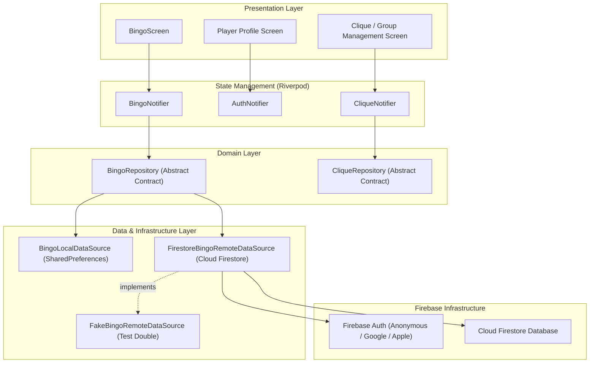

# ☁️ Backend & Cloud Sync Blueprint — Cloud Firestore & Firebase Auth

## 📌 Executive Summary

This document specifies the architectural design and implementation plan for the **Backend
Connection & Cloud Sync** feature in **Sternburg Bingo**.

The primary objectives are:

1. **Multi-Device Game Sync**: Synchronize game progress (`collectedNumbers`, `cardCounts`, custom
   cards) seamlessly across multiple devices owned by the same user.
2. **Player Profile**: Maintain lightweight user identities and profile settings.
3. **Cooperative Cliques & Groups**: Enable friends and groups ("Cliques") to join a shared room via
   an invite code and collect Bingo numbers together in real-time.

> [!NOTE]
> Since Sternburg Bingo is a companion tool for tracking physical bingo collections, anti-cheat
validation and global leaderboards are deliberately omitted in favor of zero friction, instant
offline responsiveness, and collaborative group play.

---

## 🎯 1. Core Feature Requirements & Scope

```text
┌─────────────────────────────────────────────────────────┐
│                  Firebase Authentication                │
│  • Silent Anonymous Auth on 1st launch (Zero friction)  │
│  • Optional account linking (Google / Email) for sync   │
└────────────────────────────┬────────────────────────────┘
                             │
                             ▼
┌─────────────────────────────────────────────────────────┐
│              Multi-Device Real-Time Sync                │
│  • Cloud Firestore offline persistence engine           │
│  • Automatic background sync across phone & tablet      │
└────────────────────────────┬────────────────────────────┘
                             │
                             ▼
┌─────────────────────────────────────────────────────────┐
│            Cooperative Cliques / Groups                 │
│  • Create or join a Clique via 6-digit invite code      │
│  • Group members pool collected numbers in real-time    │
│  • Shared victory celebration across all group devices  │
└─────────────────────────────────────────────────────────┘
```

---

## 🏗️ 2. Architectural Blueprint & Component Overview



---

## 🗄️ 3. Cloud Firestore Data Schema

```text
users/{userId} (Document)
  ├── displayName: String                     // e.g. "SterniFan_42"
  ├── avatarId: String                        // e.g. "avatar_crown"
  ├── createdAt: Timestamp
  ├── updatedAt: Timestamp
  └── gameState (Map)
        ├── collectedNumbers: Map<String, int> // e.g. {"12": 1, "42": 3}
        ├── cardCounts: Map<String, int>       // e.g. {"card_official_1": 1}
        └── updatedAt: Timestamp

cliques/{cliqueId} (Document)
  ├── name: String                            // e.g. "Kiez Sternis Berlin"
  ├── inviteCode: String                      // e.g. "STNI88"
  ├── ownerUserId: String
  ├── memberUserIds: List<String>
  ├── sharedCollectedNumbers: Map<String, int>// Pooled numbers collected by clique
  ├── createdAt: Timestamp
  └── updatedAt: Timestamp
```

---

## 🔄 4. Offline-First Synchronization Strategy

1. **Local First, Remote Sync**:
    - Every write operation (`addNumber`, `decrementNumber`, `incrementCardCount`) updates local
      memory/storage immediately for 0ms UI latency.
    - The write is pushed asynchronously to Cloud Firestore.
2. **Firestore Native Offline Cache**:
    - `FirebaseFirestore.instance.settings = Settings(persistenceEnabled: true)` handles offline
      queueing natively on iOS and Android.
3. **Conflict Resolution**:
    - **User Game State**: Merges numbers via max-count resolution or last-write-wins based on
      `updatedAt` server timestamps.
    - **Clique Shared Collection**: Field increments (`FieldValue.increment(1)`) ensure atomic
      concurrent additions from multiple group members without overwriting each other.

---

## 📁 5. Proposed Directory & Code Structure

```text
lib/
├── core/
│   └── auth/
│       ├── data/
│       │   ├── fake_auth_service.dart
│       │   └── firebase_auth_service.dart
│       ├── domain/
│       │   ├── auth_service.dart
│       │   └── user_profile.dart
│       └── presentation/
│           └── auth_provider.dart
└── features/
    ├── bingo/
    │   └── data/
    │       ├── bingo_remote_data_source.dart
    │       ├── fake_bingo_remote_data_source.dart
    │       └── firestore_bingo_remote_data_source.dart
    └── clique/
        ├── data/
        │   ├── clique_repository.dart
        │   └── firestore_clique_data_source.dart
        ├── domain/
        │   └── clique.dart
        └── presentation/
            ├── clique_provider.dart
            └── clique_screen.dart
```

---

## 💻 6. API Contracts & Model Definitions

### Domain Models (`AGENTS.md` compliant)

```dart
/// Immutable representation of a user profile.
final class UserProfile {
  const UserProfile({
    required this.uid,
    required this.displayName,
    required this.isAnonymous,
    this.email,
    this.cliqueId,
  });

  final String uid;
  final String displayName;
  final bool isAnonymous;
  final String? email;
  final String? cliqueId;
}

/// Abstract remote data source contract for sync.
abstract interface class BingoRemoteDataSource {
  Stream<BingoGameState> watchRemoteGameState(String userId);

  Future<void> syncGameState({
    required String userId,
    required BingoGameState gameState,
  });
}
```

---

## 🧪 7. Testing & Quality Assurance Plan

1. **Unit Tests**:
    - Test merge strategy for `BingoGameState` when local and remote states differ.
    - Test `Clique` invite code generation and membership checks.
2. **Fake Service Doubles**:
    - `FakeAuthService` and `FakeBingoRemoteDataSource` enable full offline integration testing
      without needing a live Firebase project connection or network calls.
3. **Widget Tests**:
    - Test profile view state transitions (anonymous -> linked account).
    - Test Clique creation dialog and share code copy actions.
