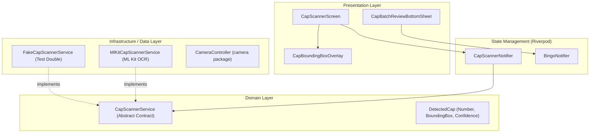

# 📷 Camera OCR Bottle Cap Scanner — Feature Blueprint

## 📌 Executive Summary

This document specifies the architectural design and implementation plan for the **Camera OCR Bottle
Cap Scanner** feature in **Sternburg Bingo**.

The feature enables users to scan a group of Sternburg bottle caps lying on a table simultaneously
using their smartphone camera. On-device Machine Learning (Google ML Kit) detects and extracts valid
bingo numbers (1–99) in real-time, displays interactive bounding overlays on the live camera stream,
and presents a human-in-the-loop review sheet to import all numbers into the game in a single tap.

---

## 🎯 1. User Experience & Flow

```text
┌────────────────────────────────┐
│ Tap "Scan Camera" Icon in UI   │
└───────────────┬────────────────┘
                │
                ▼
┌────────────────────────────────┐
│ Live Camera Viewfinder Overlay │
│  • ML Kit processes 5 FPS      │
│  • Green target rings overlay  │
│  • Real-time cap counter badge │
└───────────────┬────────────────┘
                │
                ▼
┌────────────────────────────────┐
│ Tap "Capture / Review"         │
│  • Stream pauses image frame   │
│  • Review sheet pops up        │
└───────────────┬────────────────┘
                │
                ▼
┌────────────────────────────────┐
│ Batch Review & Edit Sheet      │
│  • Interactive chips: [12][34] │
│  • Adjust counts (+ / -)       │
└───────────────┬────────────────┘
                │
                ▼
┌────────────────────────────────┐
│ Tap "Import All"               │
│  • Updates BingoGameState      │
│  • Triggers haptic victory     │
└────────────────────────────────┘
```

---

## 🏗️ 2. Architectural Blueprint & Component Overview



---

## ⚙️ 3. Frame Processing Pipeline

```text
[ Camera Image Stream (60 FPS) ]
              │
              ▼ (Frame Throttle: process 1 frame every 150–200ms)
[ Image Conversion (YUV420/BGRA8888 -> InputImage) ]
              │
              ▼
[ ML Kit Text Recognition Engine ]
              │
              ▼
[ Regex Filtering (r'^\d{1,2}$') & Range Validation (1 <= n <= 99) ]
              │
              ▼
[ Spatial Deduplication (IoU Overlap Filtering) ]
              │
              ▼
[ Temporal Stabilization (2-of-3 frame window match) ]
              │
              ▼
[ UI Bounding Box Overlay & Counter Update ]
```

### Key Processing Rules:

1. **Frame Throttling**: Process frames at **~5–6 FPS** (every 150–200 ms). Skip incoming frames
   while ML Kit processing is busy to maintain 60 FPS UI rendering.
2. **Regex & Numeric Constraints**: Match digits strictly (`1 <= n <= 99`). Filter out multi-letter
   branding text ("Sternburg", "Export", etc.).
3. **Spatial Overlap Removal**: If two bounding boxes overlap significantly
   (Intersection-over-Union > 0.5), keep only the detection with higher confidence.
4. **Temporal Stabilization**: Require a detected number at a coordinate region to persist across
   **at least 2 consecutive frames** before rendering to eliminate single-frame visual flicker.

---

## 🛡️ 4. Edge Case Mitigation Strategies

| Real-World Challenge           | Technical Root Cause                                                                                   | Architectural Mitigation                                                                                                                                          |
|:-------------------------------|:-------------------------------------------------------------------------------------------------------|:------------------------------------------------------------------------------------------------------------------------------------------------------------------|
| **Rotated / Upside-Down Caps** | Bottle caps on the table lie in arbitrary 360° orientations (e.g., `12` rotated 180° looks like `21`). | ML Kit provides rotation angle per text block. Text candidates are evaluated against bingo bounds, with human review confirmation as the final fallback.          |
| **Metal Glare & Low Light**    | Reflective metal surface obscures cap digits under direct light.                                       | Torch / Flashlight toggle built into the camera viewfinder screen + image contrast pre-checks.                                                                    |
| **Non-Number Text Noise**      | Brewery brand text printed around cap edges.                                                           | Regex pattern `r'^\d{1,2}$'` strictly discards non-numeric words.                                                                                                 |
| **Misread Digits**             | Scratched or dirty caps.                                                                               | **Human-in-the-Loop Review**: All detected numbers are presented as editable chip counts (`[12 x1] [34 x2]`) in a modal review sheet before modifying game state. |

---

## 📁 5. Directory Structure & File Placement

```text
lib/
└── features/
    └── bingo_camera/
        ├── data/
        │   ├── fake_cap_scanner_service.dart
        │   └── mlkit_cap_scanner_service.dart
        ├── domain/
        │   ├── cap_scan_result.dart
        │   ├── cap_scanner_service.dart
        │   └── detected_cap.dart
        └── presentation/
            ├── cap_scanner_notifier.dart
            ├── cap_scanner_screen.dart
            └── widgets/
                ├── cap_batch_review_bottom_sheet.dart
                └── cap_bounding_box_overlay.dart
```

---

## 💻 6. API Contracts & Model Definitions

### Domain Models (`AGENTS.md` compliant)

```dart
import 'dart:ui';

/// Immutable domain model representing a single detected bottle cap number.
final class DetectedCap {
  const DetectedCap({
    required this.number,
    required this.boundingBox,
    required this.confidence,
  });

  final int number;
  final Rect boundingBox;
  final double confidence;
}

/// Abstract interface contract for cap scanning implementations.
abstract interface class CapScannerService {
  Future<List<DetectedCap>> scanImageFrame(Object? inputImage);
}
```

---

## 🧪 7. Testing & Quality Assurance Plan

1. **Unit Tests**:
    - `MlKitCapScannerServiceTest`: Validate regex filtering, range boundaries (1–99), and spatial
      deduplication using mock text blocks.
2. **Fake Double Integration**:
    - `FakeCapScannerService`: Returns deterministic pre-defined `DetectedCap` lists for widget
      tests without requiring native camera hardware or ML binaries.
3. **Widget Tests**:
    - `CapScannerScreenTest`: Test camera UI controls (Torch button, Capture button) using
      `FakeCapScannerService`.
    - `CapBatchReviewBottomSheetTest`: Test user editing (+ / - chips) and final batch state commit.
